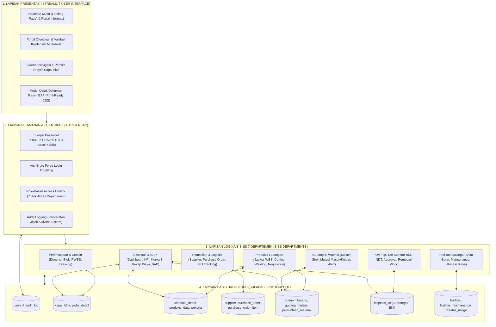

# Diagram 4.1: Arsitektur Global Sistem Terintegrasi Galangan Kapal (SIBS)

### Deskripsi untuk Bab 4:
> **Gambar 4.1 Arsitektur Sistem Terintegrasi SIBS (Shipyard Integrated Business System)**  
> Mengilustrasikan arsitektur sistem berlapis (*layered architecture*) yang menghubungkan antarmuka pengguna (*Frontend Presentation Layer*), modul logika bisnis 7 departemen (*Application & Business Logic Layer*), lapisan keamanan dan otentikasi (*Security & RBAC Layer*), serta lapisan basis data terpusat berbasis cloud (*Cloud Database Layer*) menggunakan Supabase PostgreSQL.

