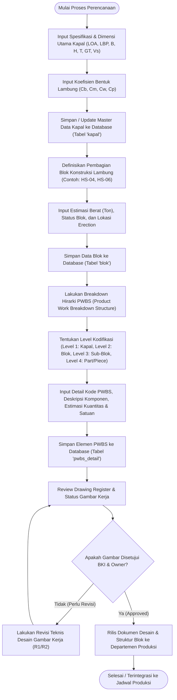

# Diagram 4.2: Flowchart Departemen Desain & Perencanaan Produksi

### Deskripsi untuk Bab 4:
> **Gambar 4.2 Diagram Alir Proses Perencanaan Desain, Blok Lambung, dan PWBS**  
> Menggambarkan tahapan teknis departemen perencanaan dimulai dari input spesifikasi dimensi utama kapal, verifikasi koefisien bentuk badan kapal (*hydrostatic & form coefficients*), pembagian blok lambung (*block division*), perincian struktur hierarki PWBS (*Product Work Breakdown Structure*), serta pengendalian status persetujuan gambar kerja (*Drawing Register*).

