# Diagram 4.3: Flowchart Departemen Produksi Lapangan

### Deskripsi untuk Bab 4:
> **Gambar 4.3 Diagram Alir Pelaksanaan dan Pengendalian Produksi Lapangan**  
> Mengilustrasikan alur operasional perakitan blok kapal, pengawasan jadwal bertahap (*WBS Schedule*), pencatatan harian fabrikasi komponen (pemotongan pelat CNC dan pengelasan lasan sambungan frame), pengajuan permintaan material (*Material Requisition*) ke gudang, serta pembaruan persentase kemajuan fisik aktual.

```mermaid
flowchart TD
    Start(["Mulai Kegiatan Produksi Lapangan"]) --> TarikJadwal["Ambil Jadwal Perakitan Blok dari Perencanaan (Tabel 'schedule_detail')"]
    TarikJadwal --> CekKebutuhan["Identifikasi Kebutuhan Komponen & Material untuk Pekerjaan Aktif"]

    CekKebutuhan --> PerluMaterial{"Apakah Material Tersedia di Lapangan?"}
    
    PerluMaterial -- "Tidak (Perlu Material)" --> FormPermintaan["Buka Form Permintaan Material ke Gudang (Material Requisition)"]
    FormPermintaan --> InputReq["Pilih Material (ID Barang), Jumlah, Target Blok, dan Tingkat Prioritas"]
    InputReq --> KirimReq["Kirim Permintaan ke Gudang (Tabel 'permintaan_material', Status: Pending)"]
    KirimReq --> TungguGudang["Menunggu Verifikasi & Pengeluaran Fisik dari Bagian Gudang"]
    TungguGudang --> TerimaMaterial["Material Diterima di Bengkel Fabrikasi Lapangan"]
    TerimaMaterial --> ProsesFabrikasi

    PerluMaterial -- "Ya (Tersedia)" --> ProsesFabrikasi["Laksanakan Pekerjaan Fabrikasi (Cutting, Fit-Up, Welding, Assembly)"]

    ProsesFabrikasi --> CatatHarian["Pencatatan Aktivitas Lapangan Harian (Tabel 'produksi_data')"]
    CatatHarian --> InputFabrikasi["Input Kode Part, Nomor Frame, Jenis Proses, Berat Komponen, Mesin, dan Operator"]
    
    InputFabrikasi --> CekQC{"Apakah Memerlukan Verifikasi Inspeksi QA/QC?"}
    CekQC -- "Ya" --> NotifQC["Notifikasi Bagian QA/QC untuk Pelaksanaan Inspeksi / Uji NDT"]
    CekQC -- "Tidak" --> HitungProgres

    NotifQC --> TungguQC["Menunggu Hasil Evaluasi Inspeksi QA/QC"]
    TungguQC --> HasilQC{"Status Hasil Uji QA/QC?"}
    
    HasilQC -- "Rejected (Defect)" --> Rework["Lakukan Pekerjaan Perbaikan / Pengelasan Ulang (Remedial Work)"]
    Rework --> CatatHarian

    HasilQC -- "Approved" --> HitungProgres["Hitung Kemajuan Fisik Pekerjaan per Sub-Pekerjaan"]
    HitungProgres --> UpdateProgres["Perbarui Persentase Selesai (%) pada Tabel 'schedule_detail'"]
    UpdateProgres --> SyncEksekutif["Data Progres Otomatis Terkoneksi ke Kurva S & Dashboard Eksekutif"]
    SyncEksekutif --> Selesai(["Pekerjaan Tahap Selesai / Lanjut ke Tahap Berikutnya"])
```

