# Diagram 4.4: Flowchart Departemen Pembelian & Logistik

### Deskripsi untuk Bab 4:
> **Gambar 4.4 Diagram Alir Manajemen Pengadaan dan Purchase Order (PO)**  
> Menggambarkan rantai pasok pengadaan material maritim (*marine grade procurement*), mulai dari verifikasi kebutuhan material proyek, pemilihan rekanan penyedia (*vendor database*), penerbitan Purchase Order berjenjang (*Draft -> Submitted -> Approved*), pemantauan pengiriman logistik, hingga serah terima barang ke gudang penyimpanan.

```mermaid
flowchart TD
    Start(["Mulai Proses Pengadaan & Logistik"]) --> CekPermintaan["Terima Rencana Kebutuhan Material Proyek atau Peringatan Stok Menipis dari Gudang"]
    CekPermintaan --> CekSupplier["Cari Supplier Terdaftar pada Master Rekanan (Tabel 'supplier')"]
    
    CekSupplier --> SupplierAda{"Apakah Supplier Terdaftar & Memenuhi Syarat?"}
    SupplierAda -- "Belum Terdaftar" --> RegistrasiSup["Input Data Perusahaan, Kategori Produk, Kontak, Telepon, dan Alamat Vendor"]
    RegistrasiSup --> SimpanSup["Simpan Vendor Baru ke Database (Tabel 'supplier')"]
    SimpanSup --> BuatPO
    
    SupplierAda -- "Sudah Terdaftar" --> BuatPO["Buka Formulir Pembuatan Purchase Order Baru"]

    BuatPO --> InputPO["Input Nomor PO, Pilihan Supplier, Tanggal PO, Target Kedatangan, dan Rincian Barang"]
    InputPO --> SimpanPODraft["Simpan Purchase Order dengan Status Awal 'Draft' (Tabel 'purchase_order')"]
    
    SimpanPODraft --> ReviewPO["Review Teknis & Kelayakan Anggaran oleh Kepala Logistik"]
    ReviewPO --> ValidasiPO{"Apakah PO Memenuhi Anggaran & Spesifikasi?"}
    
    ValidasiPO -- "Ditolak / Dibatalkan" --> BatalPO["Ubah Status PO menjadi 'Cancelled' dengan Catatan Alasan"]
    BatalPO --> Selesai(["Proses Selesai / Dibatalkan"])

    ValidasiPO -- "Disetujui" --> ApprovePO["Ubah Status PO menjadi 'Approved' (Tercatat Approver & Timestamp)"]
    ApprovePO --> KirimKeVendor["Kirim Dokumen PO Resmi ke Rekanan Supplier"]
    KirimKeVendor --> StatusSubmitted["Ubah Status PO menjadi 'Submitted' (Dalam Proses Pengiriman)"]

    StatusSubmitted --> TrackingPengiriman["Monitoring Jadwal Kedatangan & Surat Jalan Material"]
    TrackingPengiriman --> TibaGalangan{"Apakah Material Tiba di Galangan Kapal?"}
    
    TibaGalangan -- "Dalam Perjalanan" --> TrackingPengiriman
    TibaGalangan -- "Tiba di Galangan" --> SerahTerimaGudang["Lakukan Serah Terima Fisik Barang ke Departemen Gudang"]
    SerahTerimaGudang --> UpdateDelivered["Ubah Status PO menjadi 'Delivered'"]
    UpdateDelivered --> LogAuditPO["Catat Transaksi Pengadaan pada Audit Log Sistem"]
    LogAuditPO --> Selesai(["Proses Pengadaan Rampung"])
```

