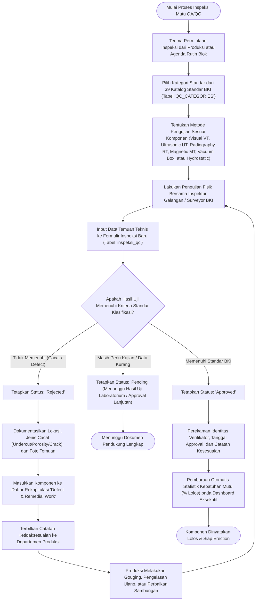

# Diagram 4.5: Flowchart Departemen Quality Assurance & Quality Control (QA/QC)

### Deskripsi untuk Bab 4:
> **Gambar 4.5 Diagram Alir Pengendalian Mutu Konstruksi Kapal Berbasis 39 Standar Uji BKI**  
> Menggambarkan mekanisme pengawasan mutu terstruktur sesuai klasifikasi Biro Klasifikasi Indonesia (BKI) dan supervisi Owner Surveyor. Meliputi permohonan inspeksi komponen blok, pengujian tanpa merusak (*Non-Destructive Testing / NDT*), verifikasi standar hasil uji, penerbitan status persetujuan (*Approved / Pending / Rejected*), hingga pengelolaan tindakan korektif (*Remedial Work*).

