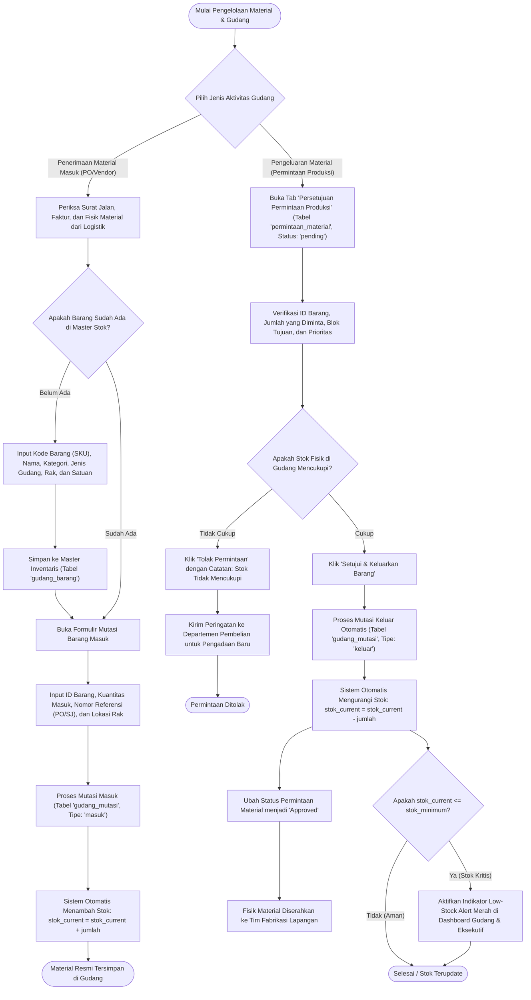

# Diagram 4.6: Flowchart Departemen Material & Gudang

### Deskripsi untuk Bab 4:
> **Gambar 4.6 Diagram Alir Pengelolaan Inventaris Material dan Mutasi Stok Gudang**  
> Mengilustrasikan pengelolaan siklus hidup material konstruksi kapal di gudang galangan (gudang terbuka/tertutup). Meliputi penerimaan barang masuk dari rekanan logistik, penempatan rak/yard, pemantauan saldo stok terkini secara dinamis, verifikasi dan pengeluaran fisik berdasarkan permintaan produksi, serta otomatisasi pemicu peringatan stok minimum (*Low-Stock Alert*).

