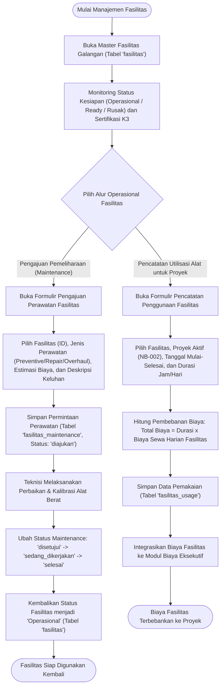

# Diagram 4.7: Flowchart Departemen Manajemen Fasilitas & Peralatan

### Deskripsi untuk Bab 4:
> **Gambar 4.7 Diagram Alir Manajemen Fasilitas, Pemeliharaan, dan Utilisasi Alat Berat**  
> Menggambarkan tata kelola kesiapan fasilitas perkapalan (*shipyard heavy equipment & dock facilities*). Meliputi pemantauan status operasional dan masa berlaku sertifikasi K3, alur pengajuan dan penanganan perawatan (*Preventive / Corrective Maintenance*), pencatatan jam/hari pemakaian alat (*facility utilization*), serta pembebanan biaya harian fasilitas ke pos anggaran pembangunan kapal.

