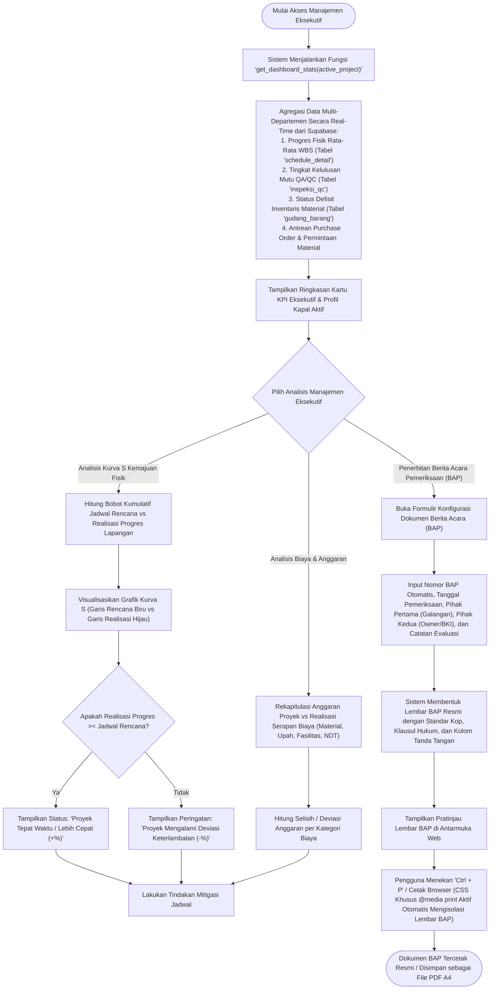

# Diagram 4.8: Flowchart Departemen Manajemen Eksekutif & Penerbitan BAP

### Deskripsi untuk Bab 4:
> **Gambar 4.8 Diagram Alir Dashboard Eksekutif, Kurva S, dan Penerbitan Berita Acara Pemeriksaan (BAP)**  
> Mengilustrasikan fungsi pengendalian strategis tingkat manajemen puncak (*Executive Level*). Meliputi agregasi data real-time dari 6 departemen operasional, pembentukan Kurva S kemajuan fisik (*Planned vs Actual S-Curve*), monitoring deviasi anggaran proyek, hingga penerbitan dan pencetakan dokumen resmi Berita Acara Pemeriksaan (BAP) kemajuan pekerjaan yang siap cetak format A4.

