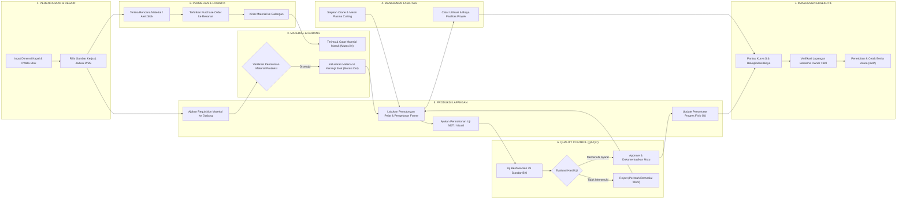

# Diagram 4.9: Cross-Functional Flowchart (Swimlane Diagram) Integrasi 7 Departemen

### Deskripsi untuk Bab 4:
> **Gambar 4.9 Diagram Alir Lintas Departemen (Cross-Functional Swimlane Diagram)**  
> Menggambarkan keterkaitan koordinasi proses bisnis secara horizontal antara ke-7 unit kerja galangan kapal (Perencanaan, Pembelian, Gudang, Produksi, Fasilitas, QA/QC, dan Eksekutif) dalam satu siklus pembangunan blok lambung kapal dari penetapan desain hingga penerbitan Berita Acara Pemeriksaan (BAP).

