# Diagram 4.10: Data Flow Diagram (DFD) Level 0 / Diagram Konteks

### Deskripsi untuk Bab 4:
> **Gambar 4.10 Data Flow Diagram (DFD) Level 0 / Diagram Konteks SIBS**  
> Menggambarkan batasan sistem informasi (*system boundary*) secara menyeluruh, memperlihatkan aliran data masuk (*input streams*) dan aliran informasi keluar (*output streams*) antara sistem SIBS dengan entitas-entitas eksternal (7 Role Departemen Galangan, Rekanan Supplier, Biro Klasifikasi Indonesia, dan Owner Surveyor).

```mermaid
flowchart TD
    SIBS(("SISTEM INFORMASI BISNIS GALANGAN KAPAL (SIBS)"))

    UserPerencanaan["Entitas: Dept. Perencanaan"]
    UserProduksi["Entitas: Dept. Produksi"]
    UserPembelian["Entitas: Dept. Pembelian"]
    UserGudang["Entitas: Dept. Gudang"]
    UserQAQC["Entitas: Dept. QA / QC"]
    UserFasilitas["Entitas: Dept. Fasilitas"]
    UserEksekutif["Entitas: Manajemen Eksekutif"]
    EntitasSupplier["Entitas Eksternal: Supplier Rekanan"]
    EntitasBKI["Entitas Eksternal: Surveyor BKI & Owner"]

    %% PERENCANAAN
    UserPerencanaan -- "Input: Dimensi Kapal, Data Blok, Kode PWBS" --> SIBS
    SIBS -- "Output: Laporan Spesifikasi Kapal & Status Gambar" --> UserPerencanaan

    %% PRODUKSI
    UserProduksi -- "Input: Aktivitas Fabrikasi, Request Material, Update Progres" --> SIBS
    SIBS -- "Output: Jadwal Perakitan Blok & Status Ketersediaan Material" --> UserProduksi

    %% PEMBELIAN
    UserPembelian -- "Input: Data Vendor, Pembuatan & Update PO" --> SIBS
    SIBS -- "Output: Daftar Kebutuhan Material & Rekap Nilai PO" --> UserPembelian

    %% SUPPLIER
    SIBS -- "Output: Lembar Purchase Order (PO)" --> EntitasSupplier
    EntitasSupplier -- "Input: Surat Jalan & Konfirmasi Pengiriman" --> SIBS

    %% GUDANG
    UserGudang -- "Input: Mutasi Masuk/Keluar, Master Barang, Approval Requisition" --> SIBS
    SIBS -- "Output: Peringatan Stok Minimum & Riwayat Transaksi Stok" --> UserGudang

    %% QA/QC
    UserQAQC -- "Input: Hasil Inspeksi 39 Kategori, Status Approval, Catatan Cacat" --> SIBS
    SIBS -- "Output: Daftar Permohonan Inspeksi & Riwayat Kepatuhan Mutu" --> UserQAQC

    %% FASILITAS
    UserFasilitas -- "Input: Request Perawatan, Pencatatan Jam Pakai Alat" --> SIBS
    SIBS -- "Output: Status Kesiapan Fasilitas & Akumulasi Biaya Sewa" --> UserFasilitas

    %% BKI & OWNER
    EntitasBKI -- "Input: Hasil Verifikasi Lapangan & Tanda Tangan Fisik" --> SIBS
    SIBS -- "Output: Dokumen Berita Acara Pemeriksaan (BAP) Terverifikasi" --> EntitasBKI

    %% EKSEKUTIF
    SIBS -- "Output: Visualisasi Kurva S, Dashboard KPI, Analisis Biaya, Dokumen BAP" --> UserEksekutif
    UserEksekutif -- "Input: Kebijakan Proyek & Approval Akhir BAP" --> SIBS
```

