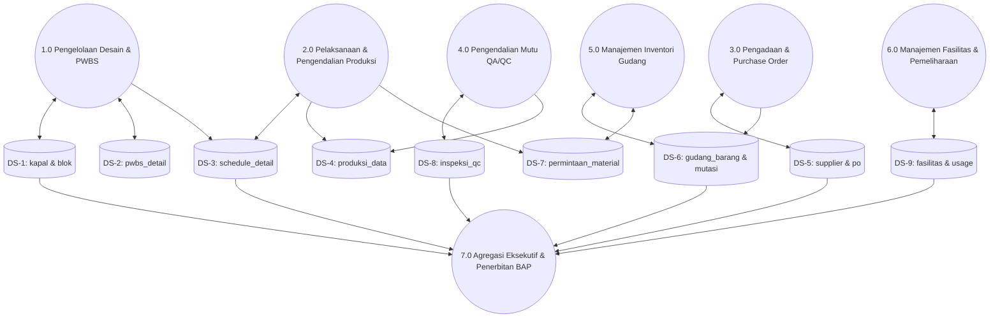

# Diagram 4.11: Data Flow Diagram (DFD) Level 1 Dekomposisi Sistem

### Deskripsi untuk Bab 4:
> **Gambar 4.11 Data Flow Diagram (DFD) Level 1 Dekomposisi Proses SIBS**  
> Menguraikan proses utama pada DFD Level 0 menjadi 7 sub-proses modular fungsional, serta memperlihatkan interaksi aliran data dua arah dengan tabel data store di Supabase PostgreSQL.

