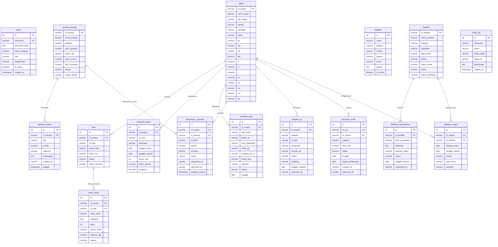

# Diagram 4.12: Entity Relationship Diagram (ERD) Database Supabase

### Deskripsi untuk Bab 4:
> **Gambar 4.12 Entity Relationship Diagram (ERD) Basis Data SIBS**  
> Memperlihatkan struktur tabel relasional, atribut kunci (*Primary Key & Foreign Key*), tipe data, dan derajat relasi (*cardinality*) antar entitas pada basis data Supabase PostgreSQL.

